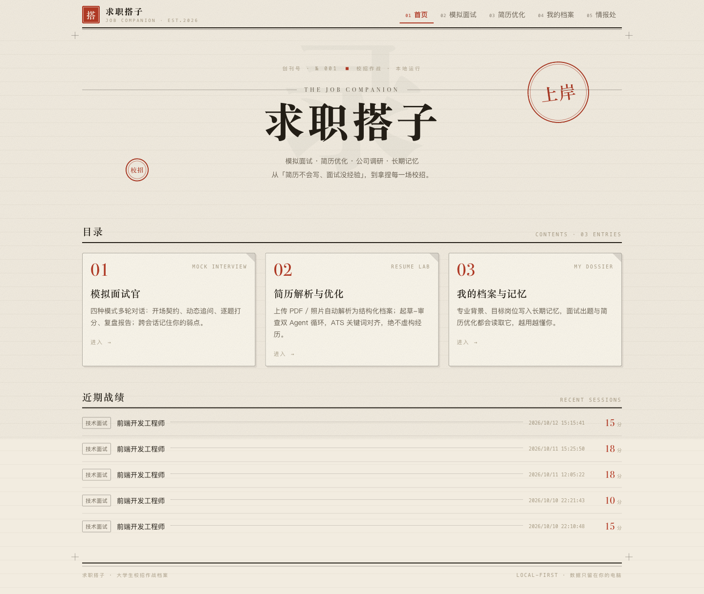
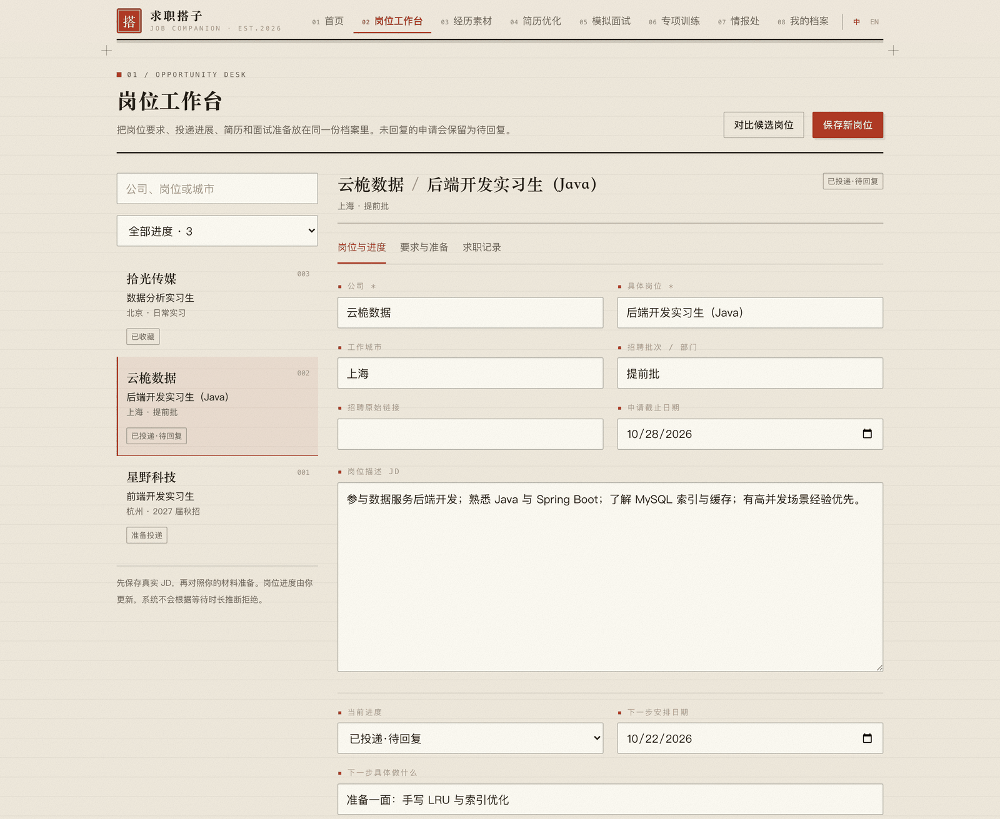
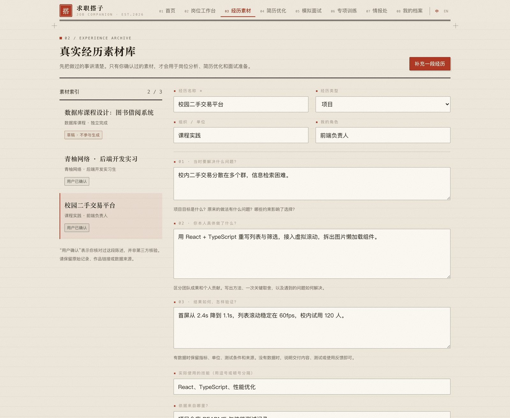
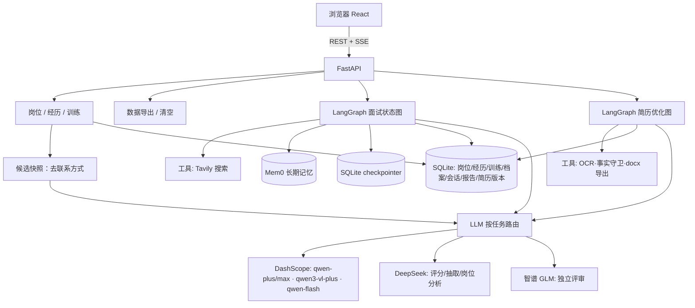

<div align="center">

<h1>🎯 求职搭子 · Job Companion</h1>

<p><b>面向大学生实习与校招的桌面求职工作台</b></p>

<p>岗位与投递 · 真实经历素材 · 简历版本 · 模拟面试 · 专项训练</p>

<p>
<a href="LICENSE"></a>


</p>

<p>FastAPI + React 全栈 ｜ LangGraph 状态机编排 ｜ 多家大模型按任务路由 ｜ 确定性规则兜底 ｜ SSE 流式输出</p>

</div>

---

> 投递记在表格里、简历改到第 7 版、面试前心里没底、公司底细又不清楚？
> 把「岗位工作台 + 简历工作室 + 模拟面试官 + 情报员」放进一个本地运行的工作台 —— 从保存 JD 到上场前的最后一次练习，材料、版本和练习记录都留得住。

## ✨ 功能一览

### 求职流程：保存岗位 → 准备材料 → 模拟面试 → 专项训练

- **岗位工作台** —— 保存 JD、公司/城市/批次、截止日期和下一步；手动维护投递状态，未回复就保持待回复，不做自动推断。岗位可关联简历版本、公司情报、模拟面试和真实面试复盘。岗位分析逐条展示 JD 原文、材料摘录、判断原因和准备行动；材料更新后提示重新分析。岗位对比并排看两到三个方向的事实与缺口，不排名、不预测结果。
- **真实经历素材库** —— 按背景、个人行动、结果与验证方式梳理项目 / 实习 / 课程 / 活动，保留来源。草稿不参与生成，只有用户确认的素材才会用于准备；「用户确认」只代表本人担保，不等同第三方核实。
- **简历工作室** —— 浏览历史文件与版本、校正解析结果、逐段编辑和恢复原材料、命名与比较版本；每个版本保存生成时的事实快照。模型不可用时也能从原材料直接建立可编辑版本；导出 DOCX，或用 A4 打印预览另存 PDF；存在未解决的事实冲突或高风险评审问题时暂停导出。
- **专项训练** —— 从模拟面试复盘或真实面试记录里挑一个能力点，创建十分钟训练；生成固定题目与 3–5 项带行为锚点的评分标准。作答后逐项引用本次回答、按标准得分汇总，保留历次回答与复测差异。练习分数只反映本轮标准达成度，不预测录用结果。
- **今日行动** —— 按日期汇总岗位下一步、申请截止和待练习任务，到期项优先；下方列出正在推进的岗位和最近的模拟面试，侧栏汇总在关注的岗位、等待回复与待练习数量。

### 能力底座

- 🎤 **模拟面试官** —— 4 种模式（行为 / 技术 / 项目深挖 / 压力），开场播报面试契约、动态追问（每题至多 2 层）、逐题自动评分，结束后生成复盘报告（五维雷达 + 逐题「更优答法」+ 改进行动）
- 📄 **简历解析** —— PDF 文本层自动识别；扫描件 / 手机照片走 Qwen 视觉模型；图片直接识别。解析结果忠实原文，不加工
- ✍️ **简历优化** —— 起草者-审查者双模型独立评审 → 修订循环；ATS 关键词对齐；**事实约束与导出检查**（技能、单位和项目匹配材料，数字检查同一经历的单位与指标；JD 差距单独列为「待补齐」，不计入正文关键词覆盖）；导出 .docx（中文安全）
- 🏢 **公司调研** —— 模拟面试开场与简历评审时真实联网搜索公司岗位要求 / 面经（Tavily，可插拔博查 / 智谱）
- 🧠 **长期记忆** —— Mem0 + Qdrant 本地向量库：记住背景、目标岗位与面试弱点；跨会话在出题与简历优化中生效；记忆管理页可查看 / 删除
- 🔄 **会话恢复** —— 面试进度持久化（LangGraph checkpointer），断线 / 刷新后聊天记录与报告完整恢复；点「停止生成」后本轮仍在后台跑完并落库
- 📊 **战绩归档** —— 档案页汇总历次面试：总分 / 单维度趋势曲线（可切换指标）、逐场归档台账；qwen-flash 跨场归并「能力短板主题」并统计复现次数（按场次指纹缓存，仅新面试后重算）
- 🕵️ **公司背调** —— 「情报处」页：4 路并行联网检索（招聘动态 / 薪资待遇 / 面试流程 / 风险信号）→ LLM 结构化抽取 + **确定性防虚构校验**（薪资数字必须对回搜索原文，无来源的风险信号直接剔除）→ SSE 进度流 → 存档可回看；每条结论附来源及可核对摘录。情报可关联岗位并带入模拟面试
- 🌐 **中英界面** —— 右上角一键切换中文 / English（localStorage 持久化，默认中文）：全站 UI 文案 + 动态进度提示联动翻译；AI 生成内容跟随生成时语言

## 🔐 数据与边界

本项目目前面向**本机单人使用**：服务默认只监听 `127.0.0.1`，没有账号与权限隔离，不要把端口直接暴露到公网或做成多人共享服务。首次启动新版后端会建出新增的 5 张表（岗位 / 岗位动态 / 经历 / 训练任务 / 训练作答），并为旧简历版本和面试表补充上下文字段，不重建或清空旧表。升级前可自行备份 `backend/data/`；前后端均需重启。

仓库里只有代码、合成样本（`backend/samples/`，虚构人物）和示例数据截图；业务数据库、上传的简历原件、导出文件、长期记忆以及 `.env` 密钥都在 `.gitignore` 中，不会随仓库分发。

业务记录与上传文件保存在配置的 `DATA_DIR`。模型解析、优化、分析与评分会发送相关内容到已配置的服务，扫描件 OCR 会发送页面图像；正文生成及岗位分析前会隐藏姓名、手机号与邮箱。并非所有处理都在本机执行。

档案页提供结构化记录 JSON 导出和本地工作区清空。JSON 导出包含敏感原始记录，不包含上传文件二进制、长期记忆或面试恢复文件，也不是一键恢复包。清空需输入 `DELETE`，有生成任务运行时拒绝操作，仅删除本项目约定的运行产物，不删除第三方服务的数据。新版将 Mem0 历史记录放在 `DATA_DIR/memory_history.db`；旧版 Mem0 默认写入工作区外的共享历史库不会被自动删除，避免影响其他应用。

桌面端为本轮范围；语音训练、在线代码执行和 Offer 选择对比暂未加入（岗位方向对比已有）。目标用户试用步骤见 [桌面版试用指南](docs/USER_TRIAL.md)，本轮模型连通与功能联调记录见 [联调记录](docs/API_SMOKE_TEST.md)。

## 🖼 界面预览

### 今日行动：先处理有时间要求的事

<p align="center">
  
</p>

### 岗位工作台：JD、进度、下一步与关联材料放在一份档案里

<p align="center">
  
</p>

### 经历素材：做了什么、怎么做到的、结果怎么验证

<p align="center">
  
</p>

> 截图使用示例数据（虚构公司与经历），不含真实个人信息。

## 🏗 架构



**三类写入路径**：岗位与经历由用户直接编辑（`PUT`），不经过模型；模型只产出分析、评分与草稿，落库前经确定性校验；清空工作区走独立路由，执行期间其他写请求被中间件拦成 `503`。

**面试状态图**（[`backend/app/agents/interview_graph.py`](backend/app/agents/interview_graph.py)）

```
START → route_turn → opening | evaluate_answer | report
evaluate_answer → after_evaluate → probe | next_question | report
```

两个路由函数是纯函数，可无 API Key 单测（[`backend/tests/test_interview_routing.py`](backend/tests/test_interview_routing.py)）。

**简历优化图**（[`backend/app/agents/resume_graph.py`](backend/app/agents/resume_graph.py)）

```
draft → review → (refine → review)* → finalize      # 最多 2 轮修订
```

**岗位分析与专项训练**（[`backend/app/tools/workspace_analysis.py`](backend/app/tools/workspace_analysis.py)）

```
JD 分析：JD + 已确认经历 + 简历版本 → 要求逐条抽取 → 回查材料出处 → 无出处标「待确认」
训练：生成时锁定 3–5 项行为锚点 → 作答 → 逐项判定并引用原句 → 按条目得分汇总
```

两条链路都只把**去联系方式后的候选快照**送给模型（[`backend/app/tools/candidate.py`](backend/app/tools/candidate.py)）；模型返回的结构化结果还要过一遍引用校验，引文对不上原文的条目不会计分。

## 🧭 技术决策（为什么这么选）

| 决策 | 理由 |
|---|---|
| **LangGraph** 而非手写 ReAct | 面试本质是确定性状态机（追问分支 / 轮次上限 / 强制出报告），条件边可断言可测试；checkpointer 免费拿到断点续聊；`astream` 多模式一次拿到 token 流 + 自定义事件 + 节点进度 |
| **Mem0** 而非自己写向量检索 | 难的不是检索而是「提取与更新」：哪些值得长期记、目标变了要覆盖、同义去重。封装为 `MemoryManager` 接口，框架可替换 |
| **起草者-审查者分离** | 审查节点用**不同厂商模型**（GLM）+ 全新上下文，保证视角独立；比单模型自审更能发现弱表述与虚构 |
| **三层防虚构** | ① 起草 prompt 硬规则 ② 确定性守卫（技能 / 单位 / 项目名 / **量化数字** 逐项对原文验证，零 LLM 成本）③ 独立评审员 LLM 复查 |
| **按任务路由模型** | 每类任务独立 `.env` 配置（见下），换模型一行切换：面试官要流式快模型、评分要严格低价、审查要换厂商、OCR 必须有视觉 |
| **OCR 双路线** | 文本层便宜快速；扫描件 / 双栏 / CID 乱码自动切 Qwen-VL 渲染识别（页图 → 转写 → 结构化 JSON） |
| **SSE 用 fetch 手写解析** | EventSource 只支持 GET、不能带请求体；前端 [`src/api/sse.ts`](frontend/src/api/sse.ts) 手写分帧解析，支持「停止生成」（AbortController） |
| **背调用确定性校验而非模型自评** | 薪资 / 规模等数字类事实由代码做「单位折算 + 全量比对」（2万 == 20k == 20000）；风险信号无公开来源直接剔除 —— 合规与可信度靠规则兜底，而非让模型「自我保证」 |
| **素材双态：草稿 / 用户确认** | 只有 `confirmed` 的经历进入生成快照，草稿只留本地。模型最容易把「没写完的经历」当事实扩写，用状态位而不是提示词来隔离 |
| **训练分数由固定标准算出** | 任务生成时锁定 3–5 项行为锚点，作答后逐项判定 0/1/2 并强制引用原句，总分 = 条目得分 / 满分，模型不直接给总分；同一标准复测才有可比差异 |
| **导出前的事实闸门** | 导出 DOCX / 打印前重跑事实与数字校验；命中未解决冲突或未确认的高风险评审时，DOCX 接口返回 `409` 和问题清单，打印页禁用打印按钮 —— 宁可不出文件，也不把错简历投出去 |
| **清空工作区走中间件** | 清空期间所有写请求 `503`、有生成任务时拒绝清空，只删本项目约定的运行产物；避免「删到一半又被写入」和误删第三方服务数据 |
| **API_NO_PROXY 定向直连** | macOS 的 Python SDK 会自动读系统代理；只给指定域名加 `NO_PROXY`，保留其他代理与证书校验，不动系统网络设置 |
| **断连后台续跑** | 图在独立任务执行 + 队列转发：客户端断开时本轮仍完整执行并提交状态，不会出现「开场跑一半」 |

## 🚀 快速开始

**前置**：Python ≥ 3.11、[uv](https://docs.astral.sh/uv/)、Node ≥ 20，以及 DeepSeek / DashScope（通义）/ 智谱 / Tavily 的 API Key。

```bash
# 1) 后端
cd backend
uv sync
cp .env.example .env          # 填入模型与搜索 Key（见下表）
uv run python -m scripts.cli ping          # 连通性自检：7 类任务模型 + Tavily
uv run uvicorn app.main:app --host 127.0.0.1 --port 8010

# 2) 前端（新终端）
cd frontend
npm install
npm run dev                   # http://localhost:5173（/api 已代理到 8010）
```

仓库根目录也提供命令：`make dev-backend` / `make dev-frontend` / `make ping` / `make test`。

后端默认只监听 `127.0.0.1`，业务记录与上传文件落在 `DATA_DIR`（默认 `backend/data/`），面向本机单人使用。

### 模型路由（`backend/.env`）

| 任务 | 默认 | 说明 |
|---|---|---|
| interview | dashscope / qwen-plus | 面试官对话（流式） |
| judge | deepseek / deepseek-chat | 答题评分、简历解析结构化、复盘报告、岗位分析、训练评分（便宜且严格） |
| ocr | dashscope / qwen3-vl-plus | 简历图片 / 扫描件（必须有视觉能力） |
| draft | dashscope / qwen-max | 简历起草与修订 |
| review | zhipu / glm-4-plus | 独立评审（故意换厂商保证视角独立） |
| mem0 | dashscope / qwen-flash | 记忆提取（高频，用便宜模型） |
| cluster | dashscope / qwen-flash | 跨场短板聚类（仅新面试后重算） |
| intel | dashscope / qwen-plus | 公司背调的结构化抽取 |
| embedding | dashscope / text-embedding-v4（1024 维） | 中文语义检索 |
| search | tavily | 备选：bocha / zhipu |

### 模型连接排查

macOS 的 Python HTTP 客户端可能自动读取系统代理，即使终端中没有设置 `HTTPS_PROXY`。
如果密钥正确，但某些服务报 `Connection error`，且底层错误为 TLS 握手提前中断
（`UNEXPECTED_EOF_WHILE_READING`），可在确认直连可用后，在 `backend/.env` 配置：

```dotenv
API_NO_PROXY=dashscope.aliyuncs.com,open.bigmodel.cn
```

重启后端后生效。该选项只让列出的域名绕过代理，保留已有的 `NO_PROXY`，
同时作用于模型、OCR 和长期记忆的 SDK；不修改系统代理，也不关闭证书校验。
留空时沿用原有网络配置。可以运行 `uv run python -m scripts.cli ping` 检查实际模型调用。

## ✅ 验证与测试

```bash
cd backend
uv run pytest -q                       # 60 项纯逻辑单测：状态机路由 / 防虚构守卫 / 结构化降级 / 工作台规则 / 配置（无需 API Key）

# 命令行验证
uv run python -m scripts.make_samples  # 生成测试简历样本（PDF / 拍照图 / 双栏）
uv run python -m scripts.cli parse-resume samples/resume_text.pdf
uv run python -m scripts.cli parse-resume samples/resume_scan.png     # 视觉路线
uv run python -m scripts.cli interview --mode technical --rounds 3 --role "Java 后端开发工程师" --company "字节跳动"
uv run python -m scripts.cli remember "我是软件工程大三学生，目标岗位是后端开发"
uv run python -m scripts.cli recall "我面试有哪些弱点"

# 浏览器端到端（需前后端都跑起来；脚本自带断言）
cd frontend
node scripts/e2e_interview.mjs   # 面试：流式 / 评分 / 报告 / 刷新恢复
node scripts/e2e_resume.mjs      # 简历：解析 / 优化 / 下载 docx / 版本对比
node scripts/e2e_intel.mjs       # 背调：4 路检索 / 校验 / 存档回看
```

脚本默认驱动本机 Microsoft Edge；换成 Chrome 或其他 Chromium 时用 `E2E_BROWSER=/path/to/browser node scripts/e2e_xxx.mjs`。

真机联调（模型连通、解析、优化、岗位分析、面试、训练逐项结果）记录在 [docs/API_SMOKE_TEST.md](docs/API_SMOKE_TEST.md)。

## 📁 目录结构

```
backend/
  app/
    agents/        # 面试图 / 简历图 / LLM 工厂 / 提示词 / 结构化模型（含工作台）
    api/           # interview(SSE) / resume / workspace / privacy / profile / memory / intel 路由
    tools/         # OCR 双路线 / 搜索三实现 / docx 导出 / 事实守卫 / 岗位分析 / 候选快照脱敏
    memory/        # Mem0 封装（背景与弱点的跨会话读取 / 写入）
    db/            # SQLAlchemy 模型（12 张表 + 兼容迁移）+ WAL 引擎
    utils/         # 三层结构化输出降级 / SSE 工具
  scripts/         # 验证 CLI / 样本生成
  tests/           # 纯逻辑单测（免 Key，60 项）
  data/            # 运行时产物（gitignore）：app.db / checkpoints.db / qdrant/ / exports/ / memory_history.db
frontend/
  src/api/         # fetch 封装 + SSE 流解析器
  src/stores/      # zustand 面试状态
  src/pages/       # 今日行动 / 岗位 / 经历 / 简历 / 打印 / 面试 / 训练 / 档案 / 情报
  src/components/  # 工作台基础组件 / 简历编辑器 / 岗位对比 / 数据管理 / 聊天与评分组件
  scripts/         # playwright 端到端脚本（驱动本机 Edge/Chrome）
```

## 💰 成本参考

| 场景 | 模型调用 | 预估成本 |
|---|---|---|
| 一场 8 题面试（含追问与复盘） | 15–20 次 | **< 0.5 元** |
| 一次简历优化（含 2 轮评审修订） | 8–12 次 | **< 0.5 元** |
| 一次公司背调（4 次搜索 + 1 次 qwen-plus） | 5 次 | **1–2 分钱** |
| 一次岗位分析（deepseek-chat，逐条对照材料） | 1 次 | **< 1 分钱** |
| 一次专项训练（生成固定标准 + 一次作答评分） | 2 次 | **< 1 分钱** |
| 记忆提取（qwen-flash） | 高频 | 可忽略不计 |

## 🎓 这个项目怎么讲（简历 / 面试）

1. **多 Agent 协作**：面试状态机（条件边路由可单测）+ 简历「起草者-审查者-修订者」循环（跨厂商模型独立评审）
2. **工作台状态建模**：岗位 ↔ 简历版本 ↔ 情报 ↔ 面试 ↔ 训练互相引用；经历分草稿与用户确认两态，简历版本存事实快照，训练按固定标准复测留差异 —— 解决「AI 生成完就散」的问题
3. **长期记忆机制**：Mem0 的记忆读写时机设计（开场读取背景与弱点、简历起草读取反馈、档案保存和复盘后写入记忆），记忆管理页可查看 / 删除
4. **可靠性工程**：LLM 结构化输出三层降级（`with_structured_output → json_mode → json_repair + 校验重试`）；防虚构三层守卫；导出前事实闸门（命中问题返回 409 与清单）；SSE 断连后台续跑；60 项免 Key 单测
5. **流式体验**：LangGraph `astream` 多模式 → SSE 事件协议（token / stage / score / report），前端手写 SSE 解析器支持中断与恢复
6. **多源情报管道**：4 路并发检索（单路失败隔离 + 瞬时重试）→ 结构化抽取 → 确定性防虚构校验（数字折算比对 / 无来源风险剔除 / 核要句级清洗）→ SSE 进度事件 → 落库存档（客户端断开照跑完）
7. **数据边界**：模型调用前去掉姓名 / 手机 / 邮箱；训练评分逐项要求原句引用并回查；导出 JSON、输入 `DELETE` 清空，清空期间中间件冻结写入
8. **工程细节**：多模型按任务路由（一行切换 provider）、SQLite WAL + checkpointer 断点续聊、docx 中文字体安全导出、上传与并发保护（409 / 锁）

## 📜 License

本项目基于 **Apache License 2.0** 开源 —— 详见 [LICENSE](LICENSE)。

> ⚠️ **依赖提示**：PDF 解析使用 [PyMuPDF](https://github.com/pymupdf/PyMuPDF)（**AGPL-3.0 / 商业双许可**）。本开源项目合规使用；若用于**闭源商业产品**，请替换为 `pypdf` / `pdfplumber`，或向 Artifex 获取商业许可。
